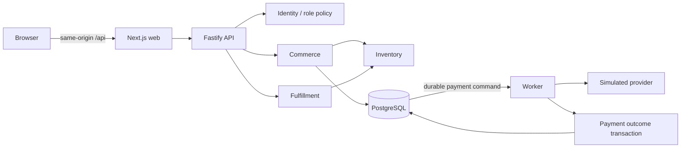

# Repository map

Forge starts as a modular monolith. The API and worker share a release and database. The browser has no direct database access.

| Location                             | Ownership                                                             |
| ------------------------------------ | --------------------------------------------------------------------- |
| `apps/web/app`                       | Routes, layout and visual styles                                      |
| `apps/web/components`                | Workspace shell and task-oriented UI                                  |
| `apps/web/lib`                       | HTTP client, runtime parsing and polling                              |
| `apps/api/src/app.ts`                | HTTP adaptation, authentication boundaries and error contract         |
| `apps/api/src/modules/identity`      | Password hashing, opaque sessions, tenant memberships and roles       |
| `apps/api/src/modules/catalog`       | Product creation, queries and optimistic updates                      |
| `apps/api/src/modules/commerce`      | Checkout, price snapshots and order reads                             |
| `apps/api/src/modules/inventory`     | Atomic reservation and settlement                                     |
| `apps/api/src/modules/payments`      | Provider adapter and transactional outcome handling                   |
| `apps/api/src/modules/fulfillment`   | Shipment transition and inventory consumption                         |
| `apps/api/src/modules/notifications` | Durable in-app payment outcome notifications                          |
| `apps/api/src/platform`              | Domain errors, audit writing and durable job processing               |
| `apps/worker`                        | Background process lifecycle                                          |
| `packages/contracts`                 | Browser-safe Zod schemas and shared response types                    |
| `packages/database`                  | Pool/transaction/migration infrastructure and authoritative SQL       |
| `scripts`                            | Development startup, isolated databases, migrations and seed fixtures |
| `tests`                              | PostgreSQL integration, API and browser tests                         |

The API owns authorization before selecting a tenant resource. Mutation services receive the resulting principal. Workers obtain tenant and aggregate IDs from committed jobs, validate the event contract, and never accept those values from model text.

The first queue table is a transactional outbox plus a single durable payment command consumer. It is not yet a general multi-subscriber event bus. Payment completion inserts a fulfillment record and notification in the same transaction; general fan-out and workflow definitions are later milestones.

The simulator's durable provider table represents an external idempotency store. Calls use a separate pool operation outside the checkout transaction. This permits a real uncertain-outcome experiment, but does not simulate all distributed provider behavior.
